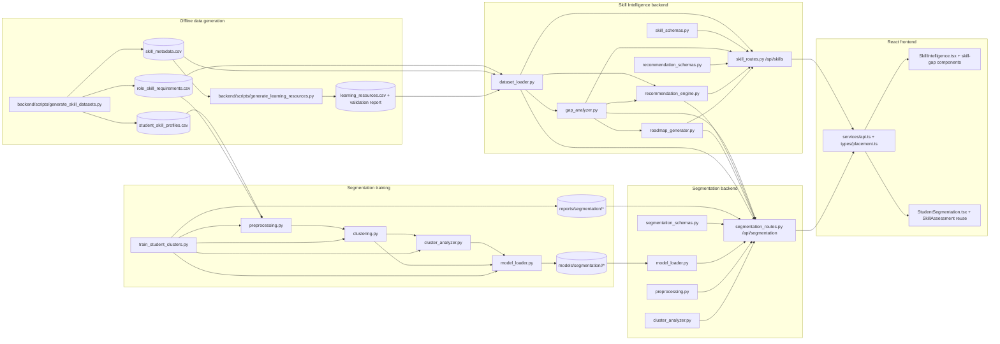
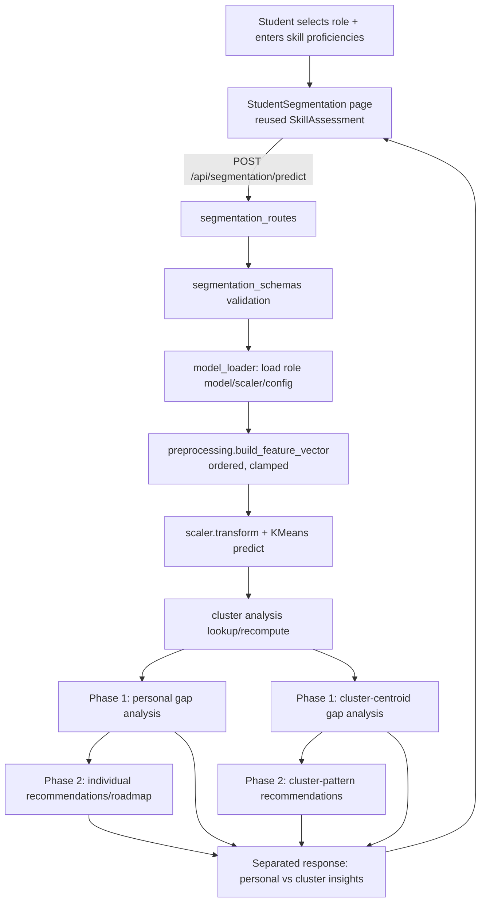

# CareerLens — Complete Technical Documentation: Skill Intelligence & Student Segmentation

**Document type:** Read-only source audit and technical reference (no application code, datasets, trained models, configurations, UI, or APIs modified during this audit)  
**Repository:** `C:\Users\Harsh\OneDrive\Desktop\TY\ML\cp` (Windows, git repo)  
**Modules covered:**  
- **Skill Intelligence** — Phase 1: Skill Gap Analysis Engine + Phase 2: Personalized Learning Recommendation Engine  
- **Student Segmentation** — Phase 3: Role-Aware K-Means Clustering

**Audit basis:** Direct inspection of source files, datasets/JSON artifacts, scripts, tests, generated reports, and frontend integration code in this repository; reconciliation of completed read-only subagent audits (Skill Intelligence frontend, Skill Intelligence backend/datasets/scripts/tests, Student Segmentation frontend/shared, Student Segmentation backend/training/tests/artifacts/reports) with direct source inspection; plus targeted verification runs executed during this audit (see [Testing and Verification](#part-6-testing-and-verification)).  
**Important:** Where prior in-thread implementation/test notes are referenced, they are labeled as **previously recorded (not re-executed now)**. Unverifiable/runtime-external claims are explicitly marked.

---

## Table of Contents

- [PART 1: Repository Inspection Summary](#part-1-repository-inspection-summary)
- [PART 2: Skill Intelligence — Complete Technical Explanation](#part-2-skill-intelligence--complete-technical-explanation)
  - [A. Phase 1 — Skill Gap Analysis Engine](#a-phase-1--skill-gap-analysis-engine)
  - [B. Phase 2 — Personalized Learning Recommendation Engine](#b-phase-2--personalized-learning-recommendation-engine)
- [PART 3: Student Segmentation — Complete Technical Explanation](#part-3-student-segmentation--complete-technical-explanation)
- [PART 4: Complete File-by-File Directory Guide](#part-4-complete-file-by-file-directory-guide)
- [PART 5: Complete Data Flow and System Architecture](#part-5-complete-data-flow-and-system-architecture)
- [PART 6: Testing and Verification](#part-6-testing-and-verification)
- [PART 7: Limitations and Important Disclosures](#part-7-limitations-and-important-disclosures)
- [PART 8: Viva and Presentation Preparation](#part-8-viva-and-presentation-preparation)
- [PART 9: Output and Audit Confirmation](#part-9-output-and-audit-confirmation)

---

## PART 1: Repository Inspection Summary

### Inspected areas (source-verified)

| Area | Key files inspected |
|---|---|
| Skill Intelligence backend | `backend/app/skill_gap/__init__.py`, `dataset_loader.py`, `gap_analyzer.py`, `skill_schemas.py`, `skill_routes.py`, `recommendation_engine.py`, `recommendation_schemas.py`, `roadmap_generator.py` |
| Skill Intelligence data/scripts | `backend/datasets/role_skill_requirements.csv`, `skill_metadata.csv`, `student_skill_profiles.csv`, `learning_resources.csv`, `learning_resources_validation_report.json`; `backend/scripts/generate_skill_datasets.py`, `generate_learning_resources.py` |
| Skill Intelligence tests | `backend/tests/test_skill_gap.py`, `backend/tests/test_skill_recommendations.py` |
| Student Segmentation backend | `backend/app/student_segmentation/__init__.py`, `preprocessing.py`, `clustering.py`, `cluster_analyzer.py`, `model_loader.py`, `segmentation_schemas.py`, `segmentation_routes.py` |
| Student Segmentation training/artifacts/reports | `backend/scripts/train_student_clusters.py`; `backend/models/segmentation/<role_id>/*` (all 6 roles present); `backend/reports/segmentation/training_summary.json`, `training_summary.md`, per-role summaries/metrics/plots/JSON |
| Student Segmentation tests | `backend/tests/test_student_segmentation.py` |
| Shared backend/frontend integration | `backend/app/__init__.py`, `frontend/src/services/api.ts`, `frontend/src/types/placement.ts`, `frontend/src/App.tsx`, `frontend/src/components/Sidebar.tsx`, `frontend/src/components/TopNav.tsx`, `README.md` (cross-check) |
| Skill Intelligence frontend | `frontend/src/pages/SkillIntelligence.tsx`, `frontend/src/components/skill-gap/RoleSelector.tsx`, `SkillAssessment.tsx`, `ReadinessScore.tsx`, `SkillGapChart.tsx`, `PrioritySkills.tsx`, `ImprovementRoadmap.tsx`, `LearningRecommendations.tsx`, `LearningRoadmap.tsx` |
| Student Segmentation frontend | `frontend/src/pages/StudentSegmentation.tsx` (+ reuse of `SkillAssessment.tsx`) |

### Verification notes
- Actual source files were read and cross-checked (including computed dataset/report statistics). This document does **not** rely solely on prior implementation reports.
- Current environment observed during audit runs: **Python 3.14.4**, **scikit-learn 1.8.0** (local). Persisted sklearn artifacts and deployment target context (from project disclosures/checkpoint) reference **Python 3.11.11 / scikit-learn 1.6.1**; unpickling/version mismatch warnings are documented in [Testing and Verification](#part-6-testing-and-verification).
- Frontend build and backend tests were executed during this audit (results recorded below). Dev servers previously started in-thread were later observed as ended (`Shell.NotFoundError`) and are **not assumed running now**.

---

## PART 2: Skill Intelligence — Complete Technical Explanation

## A. Phase 1 — Skill Gap Analysis Engine

### 1. Feature overview

**What problem it solves (`backend/app/skill_gap/__init__.py`, `gap_analyzer.py`, `skill_routes.py`, frontend page copy):**  
Phase 1 helps a student compare their current self-assessed proficiency against **role-specific, synthetic illustrative skill benchmarks** for a selected target role. It identifies gaps, prioritizes which skills to improve first, computes an explainable readiness score, and generates a simple 3-phase improvement roadmap.

**Why Skill Gap Analysis is useful:**  
- Makes role expectations explicit (required proficiency + importance/weight per skill).  
- Converts many skill inputs into prioritized, explainable guidance.  
- Separates **coverage/readiness against role benchmarks** from placement outcome prediction.

**What input it accepts:**  
- **Frontend/UI:** selected target role + slider-based proficiency values (0–100) for role-relevant skills (`SkillIntelligence.tsx`, `SkillAssessment.tsx`).  
- **API (`POST /api/skills/analyze`):** JSON `{ "target_role": "<role_id>", "skills": { "<skill name or skill_id>": <0-100 numeric>, ... } }` (`skill_schemas.py`, `skill_routes.py`). Unknown skills rejected; missing role skills default to `0.0`.

**What output it generates (`gap_analyzer.py`, `skill_routes.py`):**  
- `overall_readiness_score` (0–100, weighted coverage) + interpretation/disclaimer.  
- Per-skill `skill_comparison` (current/required/gap/gap %, importance, priority score/classification, explanations/suggestions).  
- `strongest_skills`, `skills_requiring_improvement`, `top_priority_skills` (top 5).  
- `improvement_roadmap` (3 phases: `immediate_focus`, `next_focus`, `maintain_strengths`).  
- `summary` counts by classification.

**How students use it (frontend flow):**  
Student opens Skill Intelligence → roles/metadata loaded → selects role → role requirements loaded and sliders initialized → adjusts proficiencies → clicks **Analyze My Skills** → frontend sends analyze (and recommendation) request(s) → charts/cards/roadmap displayed.

**How it differs from placement prediction:**  
- **Rule-based and explainable**; **no trained ML model** is used for Phase 1 (`skill_gap/__init__.py`, `gap_analyzer.py`, API disclaimers).  
- Readiness is **weighted skill coverage** against synthetic role benchmarks, **not a placement probability** (`gap_analyzer.analyze_skill_gap`, `skill_routes.analyze` response disclaimer).

### 2. Dataset explanation (actual CSVs)

#### `backend/datasets/role_skill_requirements.csv` (synthetic, illustrative)

| Property | Verified value |
|---|---|
| Rows / columns | **81 rows, 8 columns** |
| Columns | `role_id`, `role_name`, `skill_id`, `skill_name`, `required_proficiency`, `importance_weight`, `skill_category`, `is_core_skill` |
| Available roles (6) | `backend_developer`, `data_analyst`, `frontend_developer`, `full_stack_developer`, `ml_engineer`, `software_developer` |
| Unique skills across requirements | **33** |
| Importance weight sums (per role) | **1.0** for every role (validated in loader and generator) |

**Meaning of columns (`dataset_loader.py` validation/parsing, `generate_skill_datasets.py`):**
- `role_id`, `role_name`: target role identifiers/names.  
- `skill_id`, `skill_name`: canonical skill key and display name (consistent with `skill_metadata.csv`).  
- `required_proficiency`: benchmark proficiency (0–100) for that skill in that role.  
- `importance_weight`: positive weight contributing to role readiness; normalized so each role sums to 1.0.  
- `skill_category`: category label (e.g., Programming Languages, Databases, Frontend, Data & ML, Professional Skills).  
- `is_core_skill`: boolean-like flag (`true/false`) indicating core emphasis for the role.

**Role-wise distribution and core counts (computed from CSV):**

| Role | Skill count | Core skills | Example required skills (all names present in CSV) |
|---|---:|---:|---|
| `backend_developer` (Backend Developer) | 14 | 10 | DBMS, DSA, Express.js, Git and GitHub, Java, JavaScript, MongoDB, Node.js, OOP, Problem Solving, Python, REST APIs, SQL, System Design |
| `data_analyst` (Data Analyst) | 12 | 10 | Communication, DBMS, Data Visualization, Git and GitHub, Matplotlib, NumPy, Pandas, Probability, Problem Solving, Python, SQL, Statistics |
| `frontend_developer` (Frontend Developer) | 13 | 9 | CSS, Communication, DBMS, DSA, Git and GitHub, HTML, JavaScript, OOP, Problem Solving, REST APIs, React, SQL, Teamwork |
| `full_stack_developer` (Full Stack Developer) | 15 | 12 | CSS, Communication, DBMS, DSA, Express.js, Git and GitHub, HTML, JavaScript, MongoDB, Node.js, OOP, Problem Solving, REST APIs, React, SQL |
| `ml_engineer` (Machine Learning Engineer) | 14 | 10 | DSA, Deep Learning, Machine Learning, Matplotlib, NumPy, Pandas, Probability, Problem Solving, PyTorch, Python, SQL, Scikit-learn, Statistics, TensorFlow |
| `software_developer` (Software Developer) | 13 | 8 | C++, Communication, Computer Networks, DBMS, DSA, Git and GitHub, Java, OOP, Operating Systems, Problem Solving, Python, SQL, Teamwork |

**How weights are normalized (`generate_skill_datasets.py:build_role_rows`):** raw importance values per role are divided by role total, rounded to 6 decimals, and any floating drift is adjusted on the highest-weight entry so each role sums to exactly `1.0`. Loader (`dataset_loader._validate_role_requirement_rows`) enforces positive weights and sum ≈ 1.0 (`abs(total-1.0) <= 1e-6`).

**How core skills are represented:** `is_core_skill` stored as `"true"/"false"` in generated CSV; parsed to boolean in loader (`_to_bool`) and used in analysis explanations/suggestions/roadmap reasons.

#### `backend/datasets/skill_metadata.csv` (synthetic, illustrative)

| Property | Verified value |
|---|---|
| Rows / columns | **33 rows, 7 columns** |
| Columns | `skill_id`, `skill_name`, `skill_category`, `description`, `beginner_description`, `intermediate_description`, `advanced_description` |

**Purpose/usage:** Provides canonical skill definitions and human-readable descriptions. Loaded/validated by `dataset_loader.load_skill_metadata()` (all required fields non-empty, unique `skill_id`). Indexed by `skill_id` and lowercased `skill_name` in `get_skill_metadata_index()` for analysis enrichment (`gap_analyzer`) and frontend metadata lookup/assessment descriptions.

#### `backend/datasets/student_skill_profiles.csv` (synthetic, illustrative; not real student records)

| Property | Verified value |
|---|---|
| Rows / columns | **1000 rows, 35 columns** |
| Columns | `student_id`, `target_role`, plus **33 skill proficiency columns** (one per skill name, e.g. `Communication`, `Python`, `React`, `SQL`, etc.) |
| Role distribution | `backend_developer: 167`, `data_analyst: 166`, `frontend_developer: 167`, `full_stack_developer: 167`, `ml_engineer: 166`, `software_developer: 167` |

**How proficiency values and profiles are generated (`generate_skill_datasets.py`):**
- Reproducible RNG: `SEED = 42`, `N_STUDENTS = 1000`. Target roles assigned round-robin across the 6 roles.
- Student level buckets sampled with probabilities: **beginner 30%** (`base_shift -20, spread 11`), **intermediate 45%** (`-6, 13`), **advanced 25%** (`+4, 12`).
- Per-student latent ability and category-level biases are generated; role-relevant skills are centered around role `required_proficiency` plus latent/category/noise effects, while non-target skills use a varied baseline with modest role-pattern tendencies.
- **Correlations:** 3 iterative passes blend each skill toward the average of related skills from `CORR_GROUPS` (pull `0.22` for role-relevant, `0.15` otherwise) plus small noise.
- **Diversity/strength-weakness injection:** for role-relevant skills, samples a few strengths (+6..16) and weaknesses (-6..-18). Values clamped to `[0,100]` and rounded to integers.
- **Validation in generator:** checks row counts, duplicates, missing/extra columns, numeric ranges, diversity sanity check on first skill column, role/metadata consistency.

**Clearly synthetic:** Script and dataset loaders repeatedly state data is synthetic/illustrative, not real student records or verified industry standards.

### 3. Dataset generation (`backend/scripts/generate_skill_datasets.py`)

| Function / element | Responsibility (source-verified) |
|---|---|
| Constants/config | `SEED=42`, `N_STUDENTS=1000`, output to `backend/datasets`; canonical `SKILLS` catalog with IDs/names/categories/descriptions/level descriptions |
| `RoleDef`, `ROLES`, `_s(...)` | Defines 6 roles, their descriptions, and per-role skill tuples `(skill_id, required_proficiency, raw_importance, is_core_skill)` |
| `CORR_GROUPS` | Related-skill groups used to induce logical correlations in synthetic student profiles |
| `clamp`, `write_csv` | Utility helpers for value bounding and deterministic CSV writing |
| `build_role_rows()` | Builds `role_skill_requirements` rows; normalizes raw importance weights per role to sum 1.0 (with drift correction) |
| `build_metadata_rows(used_skill_ids)` | Emits metadata rows for all skills used in role requirements |
| `generate_student_profiles(...)` | Creates 1000 synthetic profiles with role assignment, level buckets, latent/category effects, role/non-role skill generation, correlation passes, explicit strengths/weaknesses, clamping/rounding |
| `validate_role_rows`, `validate_metadata_rows`, `validate_student_rows` | Validates duplicates, missing values, numeric/range constraints, boolean flags, per-role weight sums, role skill counts (12–18), column consistency, ID uniqueness, and basic diversity |
| `main()` | Generates rows, runs validations and cross-consistency checks (all requirement skills have metadata), writes 3 CSVs, prints summary and returns non-zero on validation failure |

**Reproducibility:** fixed `SEED` and deterministic generation/order logic; script overwrites outputs. Skill-gap dataset loaders use `@lru_cache` for runtime loading but data generation itself is controlled by the script seed.

### 4. Skill Gap Algorithm (`backend/app/skill_gap/gap_analyzer.py`)

#### Step-by-step logic (implemented)
1. **Input/validation guard:** requires `role["skills"]` to be non-empty (`ValueError` if empty).
2. **For each role-required skill (role-relevant skills only):**
   - Resolve identifiers/metadata: `skill_name`, `skill_id`, `required_proficiency` (clamped 0–100), `importance_weight`, `is_core_skill`, category, description (from `metadata_index` by `skill_id` or lowercased name, else fallback text).
   - Read current proficiency from `normalized_current_skills` by lowercased skill name; default **0.0** if missing; clamp to 0–100.
   - Compute **Gap**, **Gap Percentage**, **Weighted Skill Priority** (formulas below), and **Priority classification**.
   - Accumulate readiness: `readiness_weighted_sum += current * importance`.
   - Build explainable per-skill record (`why_it_matters`, `improvement_suggestion`).
3. **Sort `skill_comparison` (priority desc):** by `-priority_score`, `-importance_weight`, `-gap`, then `skill_name` ascending (case-insensitive).
4. **Compute overall readiness:** clamp weighted sum to `[0,100]`, round to 2 decimals.
5. **Derive collections:** `strongest_skills` = all skills sorted by `(gap asc, -current_proficiency, -importance_weight, skill_name)` then top 5; `skills_requiring_improvement` = skills where `gap > 0`; `top_priority_skills` = first 5 of priority-sorted comparison.
6. **Generate roadmap:** 3 phases from priority classification buckets (see below). Returns JSON-serializable result with interpretation/disclaimer context fields set by caller/route.

#### Exact formulas and implemented behavior

| Concept | Implemented formula/logic | Variables / notes |
|---|---|---|
| Clamping | `clamp(v)=max(0,min(100,float(v)))` | Applied to required/current values (`_clamp_proficiency`) |
| **Skill Gap** | `gap = max(0.0, required - current)` | Never negative; **if `current > required`, gap becomes 0** (no penalty) |
| **Gap Percentage** | `gap_percentage = (gap / required * 100.0) if required > 0 else 0.0` | Percentage of the required level missing |
| **Weighted Skill Priority** | `priority_score = (gap / 100.0) * importance` | Higher gap and/or higher importance => higher priority |
| **Overall Role Readiness** | `readiness = clamp_to_[0,100](Σ(current_i * importance_i))`, rounded to 2 decimals | Weighted sum over **role-relevant skills only** using normalized role weights; current values clamped 0–100; exceeding required does **not** penalize |
| **Priority classification** (`classify_gap`) | `gap <= 10 -> "Strong"`; `11..25 -> "Minor Gap"`; `26..50 -> "Moderate Gap"`; `> 50 -> "Critical Gap"` | Based on absolute gap (0–100 scale) |

**Edge cases / behavior:**
- **Missing skill input:** treated as current `0.0` (`normalized_current_skills.get(..., 0.0)`); schema also fills missing role skills to 0 during validation.  
- **Current exceeds required:** `gap=0`, `gap_percentage=0`; readiness uses actual current (clamped) * weight (so it can increase with higher current up to 100 cap effect through weighted sum).  
- **Irrelevant skills:** only `role["skills"]` (requirements for selected role) are analyzed; unknown submitted skills are rejected by request validation (not analyzed).  
- **Strongest/weakest selection:** strongest list prioritizes smallest gaps (and higher current/importance as tie-breakers). Weakest/priorities come from priority ranking (top 5).  
- **Top five priority skills:** `top_priority_skills = results[:5]` after priority sort.  
- **Improvement roadmap (`_build_roadmap`):** 3 phases populated from priority-sorted results by classification: `Critical Gap -> immediate_focus`, `Moderate Gap -> next_focus`, `Strong` or `Minor Gap -> maintain_strengths` (each item includes skill name/gap/importance/classification/reason).

#### Numerical example (illustrative, matches implemented formulas)

From `analyze_skill_gap` logic: if `Skill A` has `required=80`, `current=50`, `importance=0.6`, then `gap=30`, `gap% = 30/80*100=37.5`, `priority_score=(30/100)*0.6=0.18`, classification `Moderate Gap` (26–50). If `Skill B` has `required=60`, `current=100`, `importance=0.4`, then `gap=0`, `gap%=0`, `priority_score=0`, classification `Strong`, and overall readiness contribution is `50*0.6 + 100*0.4 = 70.0`. This mirrors the exact behavior asserted in `backend/tests/test_skill_gap.py::test_weighted_readiness_calculation` and `test_no_penalty_when_current_exceeds_required`.

### 5. Backend architecture and APIs (Phase 1)

#### File responsibilities

| File | Responsibility / key symbols |
|---|---|
| `backend/app/skill_gap/dataset_loader.py` | Loads/validates/caches synthetic benchmark datasets and curated learning resources (`DATASETS_DIR`, CSV path constants, `SkillDatasetError`, `_read_csv`, validators, cached loaders, role/metadata lookups, resource loaders/filters/summary). Source note: `_to_bool` is defined twice with slightly different accepted truthy sets (learning-resource parsing uses the later definition); `clear_cache()` clears role-requirements/metadata caches (learning-resources cache is separate). |
| `backend/app/skill_gap/gap_analyzer.py` | Rule-based Phase 1 engine: `classify_gap`, readiness/gap/priority calculations, roadmap bucketing/building, `analyze_skill_gap`. |
| `backend/app/skill_gap/skill_schemas.py` | Request normalization/validation for analyze endpoint: `normalize_target_role`, `validate_and_normalize_analyze_request` (accepts skill name/id keys, validates numerics/range, rejects unknown skills, fills missing role skills with 0.0). |
| `backend/app/skill_gap/skill_routes.py` | Flask blueprint `skill_gap_bp` (`/api/skills`) implementing Phase 1 and Phase 2 endpoints, validation/error handling, dataset disclosures, and orchestration with analyzers/recommenders. |
| `backend/app/skill_gap/__init__.py` | Exposes `skill_gap_bp` for app registration. |
| `backend/app/__init__.py` | Registers `skill_gap_bp` with Flask app factory (`create_app`). |

#### Endpoints (Phase 1)

> Base prefix: `/api/skills` (`skill_routes.py: skill_gap_bp = Blueprint(..., url_prefix="/api/skills")`)

| Endpoint | Method | Purpose | Input | Backend processing / functions called | Response (key fields) | Validation / errors |
|---|---|---|---|---|---|---|
| `/api/skills/roles` | GET | List available target roles and counts | None | `get_roles()` | `roles[]` (`role_id`, `role_name`, `skill_count`, `core_skill_count`), `count`, `disclaimer` | `503 Service Unavailable` on `SkillDatasetError` |
| `/api/skills/requirements/<role_id>` | GET | Get ordered role skill requirements/benchmarks | Path `role_id` | `get_role_requirements(role_id)` | `role_id`, `role_name`, `skill_count`, `skills[]` (id/name/required_proficiency/importance_weight/category/is_core_skill), `disclaimer` | `404 Not Found` for unknown role; `503` on dataset errors |
| `/api/skills/metadata` | GET | Get skill metadata catalog | None | `get_metadata()` | `skills[]` (id/name/category/descriptions), `count` | `503` on `SkillDatasetError` |
| `/api/skills/analyze` | POST | Run Phase 1 rule-based gap analysis | JSON body: `target_role`, `skills` map (name/id -> 0-100) | JSON checks → `validate_and_normalize_analyze_request` → `analyze_skill_gap(role, normalized_current_skills, metadata_index=get_skill_metadata_index())` → adds disclaimer | `target_role`, `role_name`, `overall_readiness_score`, `readiness_score_interpretation`, `skill_comparison[]`, `strongest_skills[]`, `skills_requiring_improvement[]`, `top_priority_skills[]`, `improvement_roadmap[]`, `summary`, `disclaimer` | `400` for non-JSON/malformed/missing/invalid fields (incl. unknown skills, out-of-range/non-numeric), `503` dataset unavailable, `500` unexpected analysis error |

**Realistic request/response examples (based on implementation/schema):**

```json
// POST /api/skills/analyze
{
  "target_role": "backend_developer",
  "skills": {
    "Java": 75,
    "Python": 60,
    "SQL": 50
  }
}
```

```json
// 200 OK (shape; values depend on role benchmarks and provided inputs)
{
  "target_role": "backend_developer",
  "role_name": "Backend Developer",
  "overall_readiness_score": 43.25,
  "readiness_score_interpretation": "Weighted skill coverage against the selected role's synthetic benchmark requirements (0-100). This is not a placement probability.",
  "skill_comparison": [
    {
      "skill_id": "dbms",
      "skill_name": "DBMS",
      "skill_category": "Databases",
      "is_core_skill": true,
      "current_proficiency": 0.0,
      "required_proficiency": 85.0,
      "gap": 85.0,
      "gap_percentage": 100.0,
      "importance_weight": 0.108696,
      "priority_score": 0.092391,
      "priority_classification": "Critical Gap",
      "description": "...",
      "why_it_matters": "Weighted importance 0.1087 for Backend Developer (core skill).",
      "improvement_suggestion": "Prioritize DBMS immediately..."
    }
  ],
  "strongest_skills": [/* up to 5 */],
  "skills_requiring_improvement": [/* gap > 0 */],
  "top_priority_skills": [/* top 5 */],
  "improvement_roadmap": [
    {"phase": "immediate_focus", "title": "Immediate Focus", "description": "...", "skills": []},
    {"phase": "next_focus", "title": "Next Focus", "description": "...", "skills": []},
    {"phase": "maintain_strengths", "title": "Maintain Strengths", "description": "...", "skills": []}
  ],
  "summary": {"total_skills": 14, "critical_gaps": 0, "moderate_gaps": 0, "minor_gaps": 0, "strong_skills": 0},
  "disclaimer": "This Skill Gap Analysis uses synthetic, illustrative role-skill benchmarks and a rule-based, explainable calculation (no trained ML model)..."
}
```

**Validation/error behavior highlights:** `skills` must be an object; proficiency values must be finite numerics (not bool/NaN/inf) in `[0,100]`; unknown skill keys for the selected role are rejected with guidance to use requirements endpoint; `target_role` must be a known role string.

### 6. Frontend architecture (Phase 1 UI)

| File / component | Purpose and key behavior (source-verified) |
|---|---|
| `frontend/src/pages/SkillIntelligence.tsx` | Orchestrates Skill Intelligence page: loads roles+metadata on mount, auto-selects first role, loads role requirements on role change, manages slider state/defaults, triggers analysis + recommendation requests, renders Phase 1 and Phase 2 sections and all loading/error/empty states. |
| `RoleSelector.tsx` | Role dropdown, loading indicator, selected-role summary (name, skill/core counts), top benchmark skills by importance, synthetic-benchmark note. |
| `SkillAssessment.tsx` | Reusable slider form (0–100, step 1) for each role requirement; resolves metadata by `skill_id`/lowercased name; shows category/core/required/description; emits `onChange(skillName,value)` and `onAnalyze`; reused by Student Segmentation. |
| `ReadinessScore.tsx` | Displays overall readiness with tone bands (`>=75` High, `>=50` Moderate, else Needs Focus), progress bar, interpretation, strongest skills preview, critical gap count and top priority preview. |
| `SkillGapChart.tsx` | Recharts visualizations from `analysis.skill_comparison`: (1) current vs required proficiency (top 10 by importance), (2) skill gap bars colored by classification (top 10 by priority where gap>0), (3) optional category averages when >1 category. |
| `PrioritySkills.tsx` | Renders up to top 5 priority skill cards with rank, classification badge, metrics (current/required/gap/importance), and why/suggestion text. |
| `ImprovementRoadmap.tsx` | Renders Phase 1 3-phase roadmap (`immediate_focus`, `next_focus`, `maintain_strengths`) with per-phase skills (up to 6 shown) and reasons. |
| `LearningRecommendations.tsx`, `LearningRoadmap.tsx` | Phase 2 UI components (documented in Phase 2 section). |
| `frontend/src/services/api.ts` | Centralized typed client with normalized base URL and skill/segmentation methods. |
| `frontend/src/types/placement.ts` | Shared contracts including skill and segmentation request/response types and `PageView`. |

**Complete frontend flow (implemented in `SkillIntelligence.tsx`):**
1. **Page load:** mount effect fetches `apiService.getSkillRoles()` and `apiService.getSkillMetadata()` in parallel (`Promise.all`), builds `metadataByKey` indexed by `skill_id` and lowercased skill name, stores roles, auto-selects first role.
2. **Role selection:** changing role triggers `apiService.getSkillRequirements(selectedRoleId)`; on success stores requirements, resolves selected role name, initializes `skillValues` via `buildDefaultValues(reqs)` (`round(required_proficiency * 0.65)` clamped to `[15,90]`); clears prior analysis/recommendation states.
3. **Proficiency input:** user adjusts sliders in `SkillAssessment` (`0..100`), values clamped/rounded in page state.
4. **Analyze action:** `handleAnalyze()` builds payload for every role requirement (`skillValues[name] ?? 0`) and runs **parallel** requests with `Promise.allSettled`: `apiService.analyzeSkillGap(...)` and `apiService.recommendSkills(...)` with default preferences `{ difficulty_preference: "adaptive", free_only: false, preferred_types: [] }`.
5. **Backend processing:** `/analyze` computes rule-based gaps/readiness/roadmap; `/recommend` reuses Phase 1 analysis internally and ranks curated resources to generate recommendations and 4-stage learning roadmap.
6. **Frontend rendering:** on analysis success renders `ReadinessScore`, `SkillGapChart`, `PrioritySkills`, `ImprovementRoadmap`, disclaimer; Phase 2 section renders loading/error-with-retry/success (`LearningRecommendations`, `LearningRoadmap`, dataset disclosure) or idle placeholder. Analysis and recommendation outcomes are handled independently.

**State/API/loading/error handling details:** page-level and role-level loading/error states, analyze error with optional details, recommendation retry (`handleRetryRecommendations` re-calls only recommend), demo reset button, and empty/placeholder states for charts/lists/roadmaps. `SkillAssessment` returns `null` if no requirements.

**API integration/base URL:** `api.ts` normalizes `VITE_API_BASE_URL` (default `/api`), preserves relative bases, appends `/api` for absolute origin roots, and routes all calls through `request<T>` with `ApiClientError` normalization. Skill methods: `getSkillRoles`, `getSkillRequirements`, `getSkillMetadata`, `analyzeSkillGap`, `getSkillResources`, `getSkillResourcesSummary`, `recommendSkills` (resources/summary methods exist but are not used by `SkillIntelligencePage` UI flow).

---

## B. Phase 2 — Personalized Learning Recommendation Engine

### 1. Feature overview

**Problem solved:** After Phase 1 identifies skill gaps/priorities, Phase 2 recommends curated learning resources and a staged learning roadmap to help close those gaps in an explainable, practical way.

**How it uses Phase 1 output:** `POST /api/skills/recommend` validates inputs, recomputes Phase 1 `analyze_skill_gap(...)`, then passes that analysis into `recommend_for_analysis(...)` and `generate_learning_roadmap(...)`. Frontend also triggers analyze and recommend in parallel from the same role/skills payload and displays Phase 2 under Phase 1 results.

**Why content-based recommendation was selected (implemented characteristics):** Matching is based on item/user-content attributes available in-project (target skill, gap/priority, proficiency-to-difficulty fit, resource quality/type/provider/free flags, preferences) rather than cross-user interaction history. No collaborative signals or user-user/item-item interaction matrix are used.

**Difference from collaborative filtering:** Collaborative filtering relies on behavior/preferences of many users/items (ratings, clicks, similar users). This implementation uses **deterministic rule-based/content matching and scoring** against curated resource metadata and the student’s current skill-gap profile.

**Not a trained ML prediction model:** Recommendation scores/ranking and roadmap sequencing are rule-based and explainable (`recommendation_engine.py`, API disclosures), not trained predictors and not probabilities/placement outcomes.

### 2. Learning resource dataset (`backend/datasets/learning_resources.csv`)

| Property | Verified value |
|---|---|
| Total resources | **165** |
| Total covered skills | **33** (all Phase 1 skills covered; 5 resources per skill) |
| Columns (15) | `resource_id`, `resource_title`, `skill_id`, `skill_name`, `provider`, `resource_type`, `difficulty_level`, `description`, `resource_url`, `estimated_hours`, `prerequisites`, `is_free`, `language`, `quality_score`, `tags` |
| Resource types | `Documentation` (76), `Course` (28), `Interactive Tutorial` (25), `Book or Reading Material` (12), `Practice Platform` (11), `Video Course` (7), `Project Tutorial` (6) |
| Difficulty distribution | `Beginner` (87), `Intermediate` (63), `Advanced` (15) |
| Free vs paid | `true` (152), `false` (13) *(dataset flag values as stored)* |

**Resource providers (actual counts):** GeeksforGeeks 15, W3Schools 12, MDN Web Docs 10, HackerRank 8, freeCodeCamp 7, Khan Academy 6, Kaggle Learn 6, Scikit-learn Documentation 5, MongoDB Documentation 4, GitHub Docs 3, Matplotlib/NumPy/pandas/PyTorch Tutorials/Microsoft Learn/React/TensorFlow/Oracle Java/Node.js/Express.js/web.dev/DigitalOcean/Python docs 2–3 each, and many providers with 1 resource (total 165 across providers as listed in dataset stats).

**Column purposes (loader/generator):** IDs/titles/URLs/providers identify resources; `skill_id`/`skill_name` map resources to Phase 1 skills; type/difficulty/hours/prerequisites/language/tags/quality/free describe suitability and ranking inputs; `resource_url` is the external learning link.

**Skill mapping and URL curation:** `skill_id`/`skill_name` must align with Phase 1 `skill_metadata` (`dataset_loader` validates `skill_id` exists in metadata index; generator fills `skill_name` from Phase 1 metadata). Resources are a curated list of real titles/URLs/providers in `generate_learning_resources.py` (no fabricated entries stated in script header). URLs were verified during dataset generation and recorded in validation report.

#### `backend/datasets/learning_resources_validation_report.json` (inspected)

| Field | Verified value |
|---|---|
| `seed` | 42 |
| `total_curated` | 165 |
| `total_written` | 165 |
| `coverage` | All 33 skills have 5 resources each |
| `url_results` | 165 entries, **165 OK, 0 failed** (at generation time) |

**Important:** URL reachability/pricing/availability can change after generation; the report is evidence of verification at dataset generation time, not a guarantee of current accessibility.

### 3. Dataset generation and validation (`backend/scripts/generate_learning_resources.py`)

| Function/section | Responsibility |
|---|---|
| Constants | Paths, required columns, valid types/difficulties, `SEED=42` |
| `load_skill_map()` | Loads Phase 1 `skill_metadata.csv` to obtain valid `skill_id -> skill_name` mapping |
| `r(...)` and `RESOURCES` list | Curated, explicit resource records (real titles/providers/URLs/metadata) for all skills |
| `validate_records()` | Checks required fields, duplicate IDs/URLs, valid skill/type/difficulty, positive estimated hours, quality score range, boolean `is_free`, fills canonical `skill_name` |
| `verify_urls()` | Performs HTTP verification (HEAD/GET attempts, retry, SSL fallback context handling) and keeps only reachable URLs (2xx/3xx accepted); records per-URL results |
| `write_csv()` | Writes deterministic CSV with required columns |
| `print_summary()` / coverage assertions | Prints counts/distributions and enforces all Phase 1 skills covered |
| `main()` | Validates curated records, verifies URLs, fails if coverage lost after verification, sorts deterministically, writes CSV and `learning_resources_validation_report.json` |

**Validation details:** duplicate detection (`resource_id`, `resource_url`), skill ID validation against Phase 1 metadata, type/difficulty enums, hours/quality/range checks, deterministic ordering, and report generation with URL results and per-skill coverage.

### 4. Recommendation engine (`recommendation_engine.py`, `recommendation_schemas.py`, `roadmap_generator.py`)

#### Verified scoring formula and weights (`recommendation_engine.py`)

**Constants:**  
`WEIGHTS = {"skill_priority": 0.40, "difficulty_match": 0.25, "resource_quality": 0.20, "relevance": 0.10, "free_resource": 0.05}`

**Primary ranking formula (non-maintenance):**  
`Recommendation Score = 0.40*SkillPriority + 0.25*DifficultyMatch + 0.20*ResourceQuality + 0.10*Relevance + 0.05*FreeResource`  
All component scores are normalized/expressed on **0–100** before weighting; final score clamped to `[0,100]` and rounded.

**Maintenance mode (Strong skills):** engine uses a different emphasis: `0.10*SkillPriority + 0.35*DifficultyMatch + 0.30*ResourceQuality + 0.20*Relevance + 0.05*FreeResource` and applies suitability adjustments (de-emphasize easier material for stronger students; bonus for practice/project/documentation relevance). Ranking metadata states maintenance recommendations emphasize difficulty fit, quality, and relevance.

#### Component calculations (implemented)

| Component | Input | Normalization/calculation | Contribution |
|---|---|---|---|
| Skill priority | Phase 1 `priority_score` per skill (`(gap/100)*importance`) | Normalized across compared skills to 0–100: `raw/max_priority * 100` (0 if max is 0) | Prioritizes resources for higher-impact gaps |
| Difficulty match | `current_proficiency` and resource `difficulty_level` | `proficiency_to_level` maps 0–30 Beginner, 31–65 Intermediate, 66–100 Advanced; `difficulty_match_score` gives 0–100 suitability (exact/near-level matches scored higher; **Advanced = 0 for Beginner**). Preference multiplier from `difficulty_preference` (`adaptive`=1.0, forced preferences allow close matches with reduced multipliers) adjusts score | Avoids unsuitable difficulty; supports adaptive/preferred difficulty |
| Resource quality | `quality_score` | Clamped to 0–100 | Prefers higher-quality curated resources |
| Relevance | `preferred_types`, resource type, maintenance context | 100 if no preferred types or type matches preference else 60; maintenance adds +10 for `Practice Platform`/`Project Tutorial`/`Documentation` (capped) | Aligns with user format preferences/use case |
| Free resource | `is_free` | 100 if free else 0 | Slightly favors free resources for easier access |

#### Matching, filtering, ranking, deduplication, explanations
- **Skill matching:** resources grouped by `skill_id`; candidate skills are Phase 1 skills with classification `Critical Gap`, `Moderate Gap`, or `Minor Gap` for primary recommendations. Strong skills receive maintenance recommendations separately.
- **Student proficiency → difficulty:** uses each skill’s `current_proficiency` to determine student level and score resource difficulty suitability.
- **Free-only / preferred types / difficulty preference:** `free_only` filters candidates (and can be applied in route before engine); `preferred_types` and `difficulty_preference` (`adaptive|beginner|intermediate|advanced`) affect relevance/prefiltering multipliers as implemented.
- **Exclusion rule:** resources with non-positive adjusted difficulty suitability are skipped (e.g., Advanced for beginners).
- **Deduplication:** within a skill, keeps highest-scoring entry per `resource_id`.
- **Ranking/selection:** sort by recommendation score/quality; `_select_diverse_top` greedily selects with soft resource-type diversity bonus, then re-sorts by actual score. Primary gap skills target **top 3–5** (fewer if insufficient unique matches); maintenance returns 1–3 as available.
- **Explanations:** `_explanations_for` generates concise “why recommended” reasons from gap classification, difficulty fit relative to current proficiency, preferred-type match, and free-resource availability (deduped, max 4; maintenance uses tailored reasons).

#### 4-stage learning roadmap generation (`roadmap_generator.py`)

| Stage key | Title | Skill assignment rule | Purpose |
|---|---|---|---|
| `immediate_focus` | Immediate Focus | `Critical Gap` | Foundational progress on most important gaps first |
| `skill_development` | Skill Development | `Moderate Gap` | Build depth with targeted learning/practice |
| `strengthening_skills` | Strengthening Skills | `Minor Gap` | Close remaining gaps / near-benchmark improvement |
| `maintain_strengths` | Maintain Strengths | `Strong` | Maintain/deepen strengths with occasional advanced/maintenance material |

**Generation details:** indexes recommendations by `skill_id` (priority recommendations first, maintenance fills Strong skills without overriding), iterates `analysis.skill_comparison` so every analyzed role skill is placed into a stage, attaches sorted recommended resource briefs and `recommended_sequence` steps, computes `estimated_resource_hours` per skill and `estimated_stage_hours` as sums of actual resource `estimated_hours`. Items are sorted within stages by priority/gap/current proficiency (reverse for non-maintenance stages). **Estimated hours are metadata-based estimates, not guaranteed completion times.**

### 5. Phase 2 APIs (`backend/app/skill_gap/skill_routes.py`, `recommendation_schemas.py`)

| Endpoint | Method | Purpose | Input | Backend processing / functions | Response (key fields) | Validation / errors |
|---|---|---|---|---|---|---|
| `/api/skills/resources` | GET | List/browse curated learning resources with filters | Query params: `skill_id`, `difficulty`, `resource_type`, `provider`, `free_only` | `validate_resource_filters` → `get_learning_resources` → `filter_learning_resources` | `resources[]`, `count`, `filters_applied`, `disclosure` | `400` invalid filters, `503` dataset unavailable, `500` unexpected |
| `/api/skills/resources/summary` | GET | Aggregate resource dataset summary | None | `get_learning_resources_summary()` | totals, covered skills, counts by difficulty/type, free vs paid, provider distribution, disclosure | `503` dataset unavailable, `500` unexpected |
| `/api/skills/recommend` | POST | Generate personalized recommendations + 4-stage roadmap (Phase 1 integrated) | JSON: `target_role`, `skills`, optional `preferences {free_only, preferred_types[], difficulty_preference}` | `validate_and_normalize_recommend_request` (reuses analyze validation + preference checks) → `analyze_skill_gap` → optional free-only prefilter → `recommend_for_analysis` → `generate_learning_roadmap` | `target_role`, `role_name`, `overall_readiness_score`, `readiness_score_interpretation`, `priority_skills`, `recommended_resources_by_skill`, `recommendation_ranking`, `learning_roadmap`, `recommendation_summary`, `preferences_applied`, `analysis_summary`, `dataset_disclosure` | `400` malformed/validation errors, `503` skill/resource dataset unavailable, `500` recommendation error |

**Preference validation (`recommendation_schemas.py`):** `difficulty_preference` in `{adaptive, beginner, intermediate, advanced}` (normalized), `preferred_types` must be valid resource types, `free_only` boolean.

**Realistic request example:**

```json
// POST /api/skills/recommend
{
  "target_role": "backend_developer",
  "skills": {"Java": 75, "Python": 60, "DSA": 45, "SQL": 50, "DBMS": 55, "Node.js": 30, "System Design": 25},
  "preferences": {
    "free_only": true,
    "preferred_types": ["Documentation", "Interactive Tutorial", "Practice Platform"],
    "difficulty_preference": "adaptive"
  }
}
```

### 6. Frontend integration (Phase 2)

| File/component | Role in Phase 2 UI |
|---|---|
| `LearningRecommendations.tsx` | Displays recommendation summary cards, client-side filters (free-only, difficulty, resource type, provider) over fetched data, grouped resources per skill with badges/scores/explanations/hours/quality/prereqs and external “Open Resource” links (`target="_blank" rel="noopener noreferrer"`), optional refresh callback. |
| `LearningRoadmap.tsx` | Renders 4-stage roadmap (`immediate_focus`, `skill_development`, `strengthening_skills`, `maintain_strengths`) with stage metrics, skills, reasons, and sequenced recommended resources/links. |
| `SkillIntelligence.tsx` | Triggers recommend in parallel with analyze, stores recommendation/loading/error state independently, supports retry for recommendations only, passes `dataset_disclosure.learning_resources` and recommendation payload to components. |
| `services/api.ts`, `types/placement.ts` | Typed `recommendSkills`/resource endpoints and Phase 2 response contracts. |

**Filters behavior:** `LearningRecommendations` applies filters **client-side** on already-fetched recommendation groups (no extra API call on filter changes). `getSkillResources`/`getSkillResourcesSummary` exist in API client but are not used by the main Skill Intelligence flow.

---

## PART 3: Student Segmentation — Complete Technical Explanation

### 1. Feature overview

**What student segmentation means:** Grouping students into clusters based on similarity in their role-relevant skill proficiency profiles (unsupervised learning), so that common cohort patterns can be summarized and interpreted.

**Why implemented:** To provide **role-aware cohort insight** (e.g., common strength/weakness patterns within a target role) and to personalize guidance by comparing an individual student to a learned segment and its centroid profile.

**Why K-Means:** Implemented as deterministic, explainable centroid-based clustering (`sklearn.cluster.KMeans`) on standardized numeric skill vectors per role, with multi-metric evaluation and artifact persistence for inference.

**Why students are clustered separately by role:** Skill relevance differs by role. Preprocessing selects **role-specific features in Phase 1 requirement order** and trains a separate scaler/model per role, avoiding mixing incomparable feature sets.

**How segmentation differs from classification and placement prediction:**  
- **Not classification:** no labeled target class is predicted from supervised training labels in this module; clusters are learned from structure in feature space.  
- **Not placement prediction:** cluster IDs/labels and evaluation metrics describe cohort similarity patterns, not hiring outcomes/probabilities (explicitly disclosed in routes/reports/frontend).

#### Supervised vs unsupervised vs K-Means (CareerLens-relevant)
- **Supervised learning:** learns a mapping from inputs to known labels/targets (e.g., placement prediction would require labeled outcomes).  
- **Unsupervised learning:** discovers structure without labeled outcomes (e.g., grouping students by similar skill profiles).  
- **K-Means clustering:** partitions data into *K* clusters by iteratively assigning points to nearest centroids and updating centroids to minimize within-cluster squared distance (inertia/WCSS) in the chosen feature space.

### 2. Dataset and role-wise feature selection

**Dataset:** `backend/datasets/student_skill_profiles.csv` — **1000 synthetic student records**, **35 columns** (`student_id`, `target_role`, 33 skill columns).  
**Role distribution:** backend_developer 167, data_analyst 166, frontend_developer 167, full_stack_developer 167, ml_engineer 166, software_developer 167.

**Feature selection (Phase 3):** For each role, features are the **Phase 1 role-required skills only**, taken in **Phase 1 role requirement order** (`preprocessing.get_role_feature_config` / `load_role_dataset`, `feature_names` from `get_role_requirements`). Irrelevant skills are excluded by constructing `X` from those role feature columns only.

| Role | Student count (trained) | Feature count | Features (ordered, role-relevant) |
|---|---:|---:|---|
| Backend Developer (`backend_developer`) | 167 | 14 | DBMS, SQL, REST APIs, DSA, Python, Java, OOP, Node.js, Express.js, System Design, MongoDB, JavaScript, Git and GitHub, Problem Solving |
| Data Analyst (`data_analyst`) | 166 | 12 | SQL, Pandas, Statistics, Python, Data Visualization, Probability, Matplotlib, NumPy, DBMS, Problem Solving, Communication, Git and GitHub |
| Frontend Developer (`frontend_developer`) | 167 | 13 | React, JavaScript, HTML, CSS, Communication, Teamwork, REST APIs, Problem Solving, Git and GitHub, DSA, Object-Oriented Programming, DBMS, SQL |
| Full Stack Developer (`full_stack_developer`) | 167 | 15 | React, JavaScript, REST APIs, Node.js, Express.js, SQL, DSA, DBMS, HTML, CSS, Git and GitHub, MongoDB, Object-Oriented Programming, Problem Solving, Communication |
| Machine Learning Engineer (`ml_engineer`) | 166 | 14 | Machine Learning, Python, Statistics, Scikit-learn, Deep Learning, Probability, NumPy, Pandas, TensorFlow, PyTorch, SQL, Matplotlib, DSA, Problem Solving |
| Software Developer (`software_developer`) | 167 | 13 | DSA, Object-Oriented Programming, Java, Problem Solving, Python, DBMS, Git and GitHub, SQL, Operating Systems, Computer Networks, C++, Communication, Teamwork |

*Sources: `backend/reports/segmentation/training_summary.json` and per-role `feature_config.json`/metadata.*

### 3. Preprocessing (`backend/app/student_segmentation/preprocessing.py`)

**Key components:** `RoleDataset` dataclass; `get_role_feature_config`; `validate_role_sample_size`; cached `_load_student_profiles_df` (loads Phase 1 `STUDENT_PROFILES_CSV`); `load_role_dataset`; `build_feature_vector`.

**Loading and filtering:** loads cached student profiles CSV, filters rows where `target_role == role_id`, requires `target_role` and `student_id`, and selects only role-required feature columns.

**Feature selection/order:** feature names/IDs taken from Phase 1 `get_role_requirements` in requirement order and preserved in `RoleDataset`, `X_df`, and runtime artifacts (`feature_config.json`, training metadata).

**Numeric validation and cleaning:**
- Coerces features to numeric (`pd.to_numeric(..., errors="coerce")`).
- Counts missing/non-numeric cells; if present, imputes with **role feature medians** and records count.
- Counts and clamps out-of-range values to `[0,100]`.
- Counts duplicate `student_id` values in role subset and **raises** if duplicates found.
- Ensures 2D matrix with expected feature count.

**Observed training summaries (all roles):** `duplicate_student_ids=0`, `missing_or_non_numeric_cells_imputed=0`, `out_of_range_cells_clamped=0` (from `training_summary.json` / role training metadata).

**StandardScaler:** `sklearn.preprocessing.StandardScaler` fit on **role training data only** during training (`clustering.train_role_segmentation`: `scaler.fit_transform(role_data.X)`), persisted as `scaler.joblib`, and reused via `scaler.transform(...)` during prediction and any recomputation (`model_loader.predict_cluster`, routes recompute path).

**Mathematical form:**  
\( z = \frac{x - \mu}{\sigma} \)  
- \(x\): original feature value, \(\mu\): feature mean from training data, \(\sigma\): feature standard deviation from training data, \(z\): standardized value.  
**Why important before K-Means:** K-Means uses distance-based assignments/objective; scaling prevents features with larger numeric ranges from dominating distance calculations and ensures inference uses the same feature space as training.

**Prediction vector construction:** `build_feature_vector(normalized_skills, feature_names)` builds an ordered `(1, n_features)` vector from lowercased skill-name map, defaults missing to `0.0`, and clamps each to `[0,100]`.

### 4. K-Means algorithm (`backend/app/student_segmentation/clustering.py`)

**Implementation settings (verified):**
- `RANDOM_STATE = 42`
- `N_INIT = 10`
- `MAX_ITER = 300`
- Candidate K range defaults: `K_MIN_DEFAULT=2`, `K_MAX_DEFAULT=8`
- Final/candidate estimator: `sklearn.cluster.KMeans(n_clusters=k, random_state=RANDOM_STATE, n_init=N_INIT, max_iter=MAX_ITER)`

**K range logic:** `candidate_k_range(n_samples)` evaluates `k` from `k_min` to `min(k_max, n_samples-1)` (requires `k < n_samples`). Sample-size precondition: `n_samples >= max(k_max + 1, k_min * 2, 10)`.

**Algorithm steps (conceptual, as implemented by sklearn KMeans on standardized data):**
1. Initialize `k` centroids (`n_init` runs / initialization handled by sklearn with fixed random state).
2. Compute distances from samples to centroids and assign each sample to nearest centroid.
3. Recompute centroids from assigned samples.
4. Repeat assignment/update until convergence or `max_iter`.

**Euclidean distance:**  
\( d(x,c)=\sqrt{\sum_{i=1}^{n}(x_i-c_i)^2} \)  
Used conceptually by K-Means in feature space; runtime centroid distances in `model_loader.predict_cluster` are obtained from `model.transform` in scaled space (distance transform) with Euclidean fallback.

**Objective / inertia (WCSS):** K-Means minimizes within-cluster sum of squared distances to assigned centroids. Implementation records this as `inertia_` (`wcss`/`inertia`) for each candidate and final model.

**Cluster ID meaning:** numeric cluster IDs are assignment indices in the trained model; **they are not meaningful semantic labels by themselves**. Human-readable labels/descriptions are generated dynamically from learned centroids and Phase 1 role requirements.

### 5. Optimal K selection and model evaluation

**Metrics computed (on standardized role-specific feature space):**

| Metric | What it measures | Interpretation in code/reports |
|---|---|---|
| **WCSS / Inertia (Elbow)** | Within-cluster compactness (sum of squared distances to centroids) | Reported for elbow analysis; decreases as K increases (not sole selection criterion) |
| **Silhouette Score** | Separation/cohesion balance of clusters | Higher is better; rank 1 assigned to highest |
| **Davies-Bouldin Index** | Average similarity between clusters (lower indicates better separation/compactness tradeoff) | Lower is better |
| **Calinski-Harabasz Score** | Ratio of between-cluster to within-cluster dispersion | Higher is better |

**Selection strategy (`select_k`):** aggregate rank across Silhouette (higher), Davies-Bouldin (lower), and Calinski-Harabasz (higher). Tie-breakers: lower total rank, higher silhouette, then smaller K (parsimony). Rationale explicitly states WCSS is reported for elbow analysis and K is not chosen by a single metric.

**Actual selected K and metrics (from `backend/reports/segmentation/training_summary.json`):**

| Role | Samples | Features | Selected K | Silhouette | Davies-Bouldin | Calinski-Harabasz | WCSS |
|---|---:|---:|---:|---:|---:|---:|---:|
| Backend Developer | 167 | 14 | 2 | 0.24604226012277203 | 1.424495240401174 | 72.37902648351955 | 1625.122512779294 |
| Data Analyst | 166 | 12 | 2 | 0.291372435314659 | 1.2651578274320752 | 96.957790684808 | 1251.8806169484426 |
| Frontend Developer | 167 | 13 | 2 | 0.3153917094681985 | 1.1994740344579258 | 110.01856886278156 | 1302.5120502998789 |
| Full Stack Developer | 167 | 15 | 2 | 0.2692961706051056 | 1.3238573638211029 | 89.09468360839739 | 1626.657410262874 |
| Machine Learning Engineer | 166 | 14 | 2 | 0.2994616009321471 | 1.2095553147087714 | 106.7888233351561 | 1407.502700095812 |
| Software Developer | 167 | 13 | 2 | 0.2637790619357428 | 1.379410071985099 | 83.63749757882626 | 1440.7118937739228 |

**Why `selected_k = 2` for all roles (current artifacts):** for each role, K=2 was the best (rank 1) on Silhouette, Davies-Bouldin, and Calinski-Harabasz in the evaluated range `2..8`, resulting in the lowest aggregate rank and therefore selected by the implemented strategy (per `training_summary.json` candidate metrics/ranks/metric leaders/rationales).

**Disclosure:** clustering metrics describe internal structure on synthetic data and **do not prove real-world cluster quality**; they are **not accuracy**.

### 6. Cluster interpretation (`backend/app/student_segmentation/cluster_analyzer.py`)

**How numerical clusters are interpreted:** `analyze_role_clusters(...)` computes, per cluster, mean proficiency per role-relevant skill (original scale), overall cluster average, student counts/percentages, differences vs overall role cohort averages, strongest/weakest skills, category profiles, and comparisons vs Phase 1 role requirements. It generates **dynamic cluster names and descriptions** from learned centroid-derived statistics and requirement comparisons (no hardcoded labels like “Cluster 0 = Beginner”).

**Naming/description logic (implemented):** compares cluster averages to overall cohort and requirement benchmarks; derives level tendency (`Above-Average`, `Balanced`, `Foundational` based on overall delta thresholds), identifies notable positive/negative skill deltas, and composes evidence-based text including strengths/needs, counts of skills at/above vs below requirements, category tendencies, and synthetic-profile caveat.

**Actual cluster summaries (all roles, from `training_summary.json`):**

| Role | Cluster | Name | Students | Avg proficiency | Strongest skills (examples) | Weakest skills (examples) | Main characteristics (summary) |
|---|---|---|---:|---:|---|---|---|
| Backend Developer | 0 | Developing Python & SQL Profile | 61 (36.53%) | 53.06 | Python, SQL | Express.js, MongoDB | Lower than cohort average overall; lags on backend/framework-related areas |
| Backend Developer | 1 | Strong Node.js & REST APIs Profile | 106 (63.47%) | 69.06 | Node.js, REST APIs | Express.js, MongoDB | Above cohort average overall; stronger backend/API profile |
| Data Analyst | 0 | Developing DBMS & Python Profile | 86 (51.81%) | 53.43 | DBMS, Python | Git and GitHub, Problem Solving | Lower cohort-average profile with foundational gaps in some analysis/support skills |
| Data Analyst | 1 | Strong Git/GitHub & Matplotlib Profile | 80 (48.19%) | 71.34 | Git and GitHub, Matplotlib | Problem Solving, NumPy | Above cohort average with stronger tooling/visualization tendencies |
| Frontend Developer | 0 | Strong Problem Solving & CSS Profile | 87 (52.10%) | 66.54 | Problem Solving, CSS | SQL, DBMS | Above cohort average; stronger frontend/professional/problem-solving signals |
| Frontend Developer | 1 | Developing OOP & SQL Profile | 80 (47.90%) | 47.50 | OOP, SQL | DBMS, React | Below cohort average; broader gaps across frontend/core skills |
| Full Stack Developer | 0 | Strong Git/GitHub & Node.js Profile | 92 (55.09%) | 68.10 | Git and GitHub, Node.js | Communication, Express.js | Above cohort average with stronger full-stack engineering/tooling profile |
| Full Stack Developer | 1 | Developing OOP & Communication Profile | 75 (44.91%) | 50.35 | OOP, Communication | Express.js, MongoDB | Below cohort average with developing cross-stack competencies |
| ML Engineer | 0 | Strong Statistics & Matplotlib Profile | 79 (47.59%) | 75.46 | Statistics, Matplotlib | SQL, PyTorch | Highest-average ML segment; strong stats/math/ML foundations |
| ML Engineer | 1 | Developing SQL & TensorFlow Profile | 87 (52.41%) | 56.89 | SQL, TensorFlow | PyTorch, Deep Learning | Lower-average segment with gaps in advanced ML/deep learning areas |
| Software Developer | 0 | Developing DBMS & Computer Networks Profile | 78 (46.71%) | 48.68 | DBMS, Computer Networks | Problem Solving, C++ | Below cohort average; developing fundamentals/systems/problem-solving areas |
| Software Developer | 1 | Strong Problem Solving & Operating Systems Profile | 89 (53.29%) | 65.95 | Problem Solving, Operating Systems | C++, Communication | Above cohort average with stronger core CS/problem-solving profile |

*Detailed per-skill centroid means, requirement comparisons, and category profiles are stored in per-role `cluster_analysis.json` files (models/reports copies).*

### 7. Model training and artifact generation

**Training script:** `backend/scripts/train_student_clusters.py` (CLI supports `--roles`). Workflow: bootstrap paths/imports, set non-interactive matplotlib backend, load roles/datasets, validate sample sizes, train/evaluate/select K per role, generate dynamic cluster analysis, save runtime artifacts and per-role reports/plots/summaries, aggregate global `training_summary.json` and `training_summary.md`, exit non-zero if errors and no roles trained.

**Per-role runtime artifacts (`backend/models/segmentation/<role_id>/`):** all 6 roles contain
- `kmeans_model.joblib` — trained `sklearn.cluster.KMeans` model
- `scaler.joblib` — fitted `StandardScaler`
- `feature_config.json` — role/feature order and skill IDs used for inference
- `training_metadata.json` — algorithm params, K range/selection, metrics, preprocessing/data summary
- `cluster_analysis.json` — dynamic cluster interpretation/profile data

**Reports (`backend/reports/segmentation/`):**
- Global: `training_summary.json`, `training_summary.md`
- Per role (`<role_id>/`): `<role>_k_evaluation_metrics.csv`, `<role>_training_metadata.json`, `<role>_cluster_analysis.json`, `<role>_summary.json`, and plots: `<role>_elbow_wcss.png`, `<role>_silhouette_by_k.png`, `<role>_davies_bouldin_by_k.png`, `<role>_calinski_harabasz_by_k.png`, `<role>_cluster_distribution.png`, `<role>_cluster_profiles.png`, `<role>_pca_clusters.png`

**PCA visualization:** generated per role as a 2D scatter (`_plot_pca_clusters`) for interpretability/visual inspection; clustering/training/metrics are performed in the **standardized role feature space**, not in PCA-reduced space.

### 8. Individual student segmentation and Phase 1/2 reuse

**Runtime components:** `model_loader.py` (artifact load/save/discovery/predict), `segmentation_schemas.py` (request validation/normalization), `segmentation_routes.py` (endpoints and orchestration).

**Exact prediction flow (`POST /api/segmentation/predict`):**
1. Student selects target role and provides proficiency scores (frontend assessment/payload).
2. Backend validates JSON payload and role/skills via `validate_predict_request` (role must exist in Phase 1 mappings; skills must be role-relevant by name/id, numeric, 0–100; missing role skills filled to 0.0).
3. Loads role-specific trained artifacts (`model`, `scaler`, `feature_config`, `training_metadata`) and cluster analysis.
4. Builds ordered feature vector in model/role feature order (`build_feature_vector`).
5. Scales input with persisted `StandardScaler` and predicts cluster (`predict_cluster` using `model.predict` on transformed input; centroid distances in scaled space via `model.transform` or Euclidean fallback).
6. Retrieves predicted cluster characteristics and computes student-vs-cluster and student-vs-overall comparisons, strongest/weakest relative skills, and “why this cluster” explanations.
7. **Phase 1 reuse:** computes **personal skill gaps** with `gap_analyzer.analyze_skill_gap` on submitted student profile, and computes **cluster-centroid representative gaps** by applying the same Phase 1 gap analyzer to the predicted cluster’s average proficiency profile (using Phase 1 role mappings/requirements/metadata).
8. **Phase 2 reuse:** loads curated resources and calls `recommendation_engine.recommend_for_analysis` separately for personal gaps and cluster-centroid pattern gaps (and can generate a personal roadmap via `roadmap_generator.generate_learning_roadmap`); also suggests resources for cluster weaknesses. Existing engine/resources are reused (no duplicate resource dataset/logic).
9. Returns separated sections for `personal_skill_gaps`, `cluster_level_weaknesses`, `recommendations_based_on_individual_gaps`, `recommendations_based_on_cluster_patterns`, plus `integration_notes` clarifying the distinction.

### 9. Backend APIs (Student Segmentation)

Base prefix: `/api/segmentation` (`segmentation_bp`)

| Endpoint | Method | Purpose | Input | Backend processing / key functions | Response (key fields) | Validation / errors |
|---|---|---|---|---|---|---|
| `/api/segmentation/roles` | GET | List roles with available trained segmentation models | None | `list_available_segmentation_roles`, Phase 1 `get_roles`, loads metadata when available | `roles[]`, `count`, `disclosure` | `500` dataset/internal errors (per route handling) |
| `/api/segmentation/overview/<role_id>` | GET | Segmentation overview for a role | Path `role_id` | role existence + artifact checks, `load_role_artifacts`, `_get_cluster_analysis`, metadata/metrics extraction | role identity, `n_clusters`, `students_analyzed`, `cluster_distribution`, `selected_k`, `clustering_evaluation_metrics`, `candidate_k_metrics`, `k_selection`, `overall_clustering_summary`, `disclosure` | `400` empty role, `404` unsupported/missing artifacts, `500` dataset/internal |
| `/api/segmentation/clusters/<role_id>` | GET | Detailed cluster profiles for a role | Path `role_id` | role/artifact checks, artifact load, cluster analysis retrieval | `role_id`, `role_name`, `selected_k`, `students_analyzed`, `clusters[]` (dynamic names/descriptions, counts, averages, per-skill profiles, strongest/weakest, category profiles, comparisons), `disclosure` | `404`/`500` as applicable |
| `/api/segmentation/predict` | POST | Predict a student’s segment and return individual + cluster insights | JSON `{target_role, skills{...}}` | `validate_predict_request` → load artifacts/analysis → vectorize/scale/predict → comparisons/why → Phase 1 personal + cluster-centroid gap analyses → Phase 2 recommendations for both | predicted cluster fields, characteristics, strongest/weakest, comparison table data, improvement areas, `why_this_cluster`, `personal_skill_gaps`, `cluster_level_weaknesses`, `recommendations_based_on_individual_gaps`, `recommendations_based_on_cluster_patterns`, `integration_notes`, `disclosure` | `400` validation errors, `404` missing model/artifacts/cluster resolution issues, `500` dataset/internal |
| `/api/segmentation/model-info/<role_id>` | GET | Model/training metadata for a role | Path `role_id` | role/artifact checks, load artifacts/metadata | `model_type`, `selected_k`, `training_sample_count`, `feature_count`, `feature_names`, `training_metadata` (algorithm/params/selection/preprocessing), `evaluation_metrics`, `candidate_k_metrics`, `disclosure` | `404`/`500` as applicable |

**Realistic predict request example (schema-based):**

```json
{
  "target_role": "frontend_developer",
  "skills": {
    "React": 75,
    "JavaScript": 70,
    "CSS": 80,
    "HTML": 78
  }
}
```

### 10. Frontend implementation (`frontend/src/pages/StudentSegmentation.tsx`)

**Core behavior (source-verified):**
- **Initial load:** fetches `getSegmentationRoles()` and `getSkillMetadata()` in parallel, filters to available roles, builds `metadataByKey` by `skill_id` and lowercased skill name, auto-selects first available role.
- **Role selection/data load:** on role change fetches `getSegmentationOverview`, `getSegmentationClusters`, and `getSkillRequirements` in parallel; initializes assessment defaults from role requirements (`round(required*0.65)` clamped `[15,90]`).
- **Dashboard sections:** overview cards (clusters/students analyzed/selected K/silhouette), cluster distribution bar chart, cluster skill comparison chart (centroid averages per skill), cluster profile cards (dynamic names/descriptions/stats/strongest/weakest), evaluation metrics and K-selection rationale, disclosures.
- **“Find My Student Segment”:** reuses `SkillAssessment` for input; on predict sends `{target_role, skills}` to `predictStudentSegment`; renders predicted cluster info, why-this-cluster explanations, strongest/weakest vs cluster, comparison chart/highlights, separate personal-gap vs cluster-weakness panels, and separate individual-gap vs cluster-pattern recommendations plus integration notes.
- **State handling:** page/role/predict loading and error states, empty/no-model states, reset-to-default assessment values.

**Endpoint-to-UI data mapping:**

| UI/data | Endpoint |
|---|---|
| Available trained roles, metadata for labels | `GET /api/segmentation/roles`, `GET /api/skills/metadata` |
| Overview cards, distribution, K/metrics/rationale | `GET /api/segmentation/overview/<role_id>` |
| Cluster profiles and centroid comparison chart data | `GET /api/segmentation/clusters/<role_id>` |
| Assessment sliders/requirements | `GET /api/skills/requirements/<role_id>` |
| Personal prediction and integrated insights | `POST /api/segmentation/predict` |

**Shared integration:** uses centralized `apiService` and shared TypeScript types (`PageView` includes `student-segmentation`); routing/nav/title wiring in `App.tsx`, `Sidebar.tsx`, `TopNav.tsx`. `getSegmentationModelInfo` exists in client/types but is not called by the inspected segmentation page.

---

## PART 4: Complete File-by-File Directory Guide

### A. Skill Intelligence and shared files

| File Path | Purpose | What is implemented inside | Important functions/classes |
|---|---|---|---|
| `backend/app/skill_gap/__init__.py` | Module export/registration surface | Exposes Phase 1/2 blueprint | `skill_gap_bp`, `__all__` |
| `backend/app/skill_gap/dataset_loader.py` | Dataset/resource loading, validation, caching, filtering | CSV path constants, schema/value validation for role requirements/metadata/learning resources, cached loaders, role/metadata lookups, learning-resource grouping/filtering/summary. Source nuance: `_to_bool` is defined twice with different accepted truthy sets (later definition used in learning-resource loading); `clear_cache()` clears role-requirements/metadata caches only. | `SkillDatasetError`, `load_role_requirements`, `load_skill_metadata`, `get_roles`, `get_role_requirements`, `get_skill_metadata_index`, `get_learning_resources`, `get_learning_resources_by_skill`, `filter_learning_resources`, `get_learning_resources_summary` |
| `backend/app/skill_gap/gap_analyzer.py` | Phase 1 rule-based engine | Gap/priority/readiness calculations, classification, roadmap bucketing/building, analysis assembly | `classify_gap`, `_build_roadmap`, `analyze_skill_gap` |
| `backend/app/skill_gap/skill_schemas.py` | Phase 1 request validation/normalization | Target role normalization, skill key normalization (name/id), numeric/range checks, unknown-skill rejection, missing-skill defaults | `normalize_target_role`, `validate_and_normalize_analyze_request` |
| `backend/app/skill_gap/skill_routes.py` | Skill Intelligence REST API (Phase 1 + Phase 2) | Endpoints for roles/requirements/metadata/analyze/resources/summary/recommend with validation, orchestration, disclosures, error handling | `skill_gap_bp`, `list_roles`, `role_requirements`, `skill_metadata`, `analyze`, `list_resources`, `resources_summary`, `recommend` |
| `backend/app/skill_gap/recommendation_engine.py` | Phase 2 content-based/rule-based ranking engine | Difficulty mapping/scoring, component scoring, explanations, diversity-aware top selection, per-skill and maintenance recommendations | `WEIGHTS`, `proficiency_to_level`, `difficulty_match_score`, `recommend_for_analysis` |
| `backend/app/skill_gap/recommendation_schemas.py` | Phase 2 request/filter validation | Resource filter parsing/validation and recommend preference/request validation (reuses analyze validation) | `validate_resource_filters`, `validate_and_normalize_recommend_request` |
| `backend/app/skill_gap/roadmap_generator.py` | Phase 2 4-stage roadmap builder | Stage assignment, resource sequencing/briefs, estimated hours aggregation, stage ordering | `generate_learning_roadmap` |
| `backend/scripts/generate_skill_datasets.py` | Phase 1 synthetic dataset generator | Generates role requirements, skill metadata, and student profiles with validation and reproducibility | `build_role_rows`, `build_metadata_rows`, `generate_student_profiles`, validators, `main` |
| `backend/scripts/generate_learning_resources.py` | Phase 2 curated resource dataset generator/validator | Curated resource definitions, schema checks, URL verification, CSV/report generation | `validate_records`, `verify_urls`, `write_csv`, `print_summary`, `main` |
| `backend/datasets/role_skill_requirements.csv` | Synthetic role-skill benchmark data | Role/skill mappings, required proficiency, weights, categories, core flags | Data file (81 rows) |
| `backend/datasets/skill_metadata.csv` | Skill catalog metadata | Descriptions and level-wise explanations for skills | Data file (33 rows) |
| `backend/datasets/student_skill_profiles.csv` | Synthetic student profiles | Student IDs, target roles, and per-skill proficiency values | Data file (1000 rows) |
| `backend/datasets/learning_resources.csv` | Curated learning resources | Genuine resource metadata and URLs mapped to skills | Data file (165 rows) |
| `backend/datasets/learning_resources_validation_report.json` | Generation-time validation evidence | Seed, curated/written counts, URL verification results, per-skill coverage | JSON report |
| `backend/tests/test_skill_gap.py` | Phase 1 test suite | Dataset loading, algorithm correctness, edge cases, API behavior/validation | Pytest tests for loader/analyzer/routes |
| `backend/tests/test_skill_recommendations.py` | Phase 2 test suite | Resource loading/filtering, scoring/difficulty matching, roadmap, recommend/resources APIs, integration/validation | Pytest tests for resources/recommender/roadmap/routes |
| `frontend/src/pages/SkillIntelligence.tsx` | Skill Intelligence page orchestration | Loads roles/metadata/requirements, manages assessment state, runs analyze+recommend, renders Phase 1/2 UI and states | `SkillIntelligencePage`, `buildDefaultValues`, handlers/effects |
| `frontend/src/components/skill-gap/RoleSelector.tsx` | Role selection UI | Dropdown and selected-role benchmark summary | `RoleSelector` |
| `frontend/src/components/skill-gap/SkillAssessment.tsx` | Proficiency input UI (reusable) | Slider-based assessment form and analyze trigger | `SkillAssessment` |
| `frontend/src/components/skill-gap/ReadinessScore.tsx` | Phase 1 summary UI | Readiness score, tone/progress, strongest/critical-gap previews | `ReadinessScore` |
| `frontend/src/components/skill-gap/SkillGapChart.tsx` | Phase 1 chart UI | Current-vs-required, gap, and category charts | `SkillGapChart` |
| `frontend/src/components/skill-gap/PrioritySkills.tsx` | Phase 1 priorities UI | Top 5 priority skill cards | `PrioritySkills` |
| `frontend/src/components/skill-gap/ImprovementRoadmap.tsx` | Phase 1 roadmap UI | 3-phase roadmap rendering | `ImprovementRoadmap` |
| `frontend/src/components/skill-gap/LearningRecommendations.tsx` | Phase 2 recommendations UI | Summary, client-side filters, grouped resource cards and links | `LearningRecommendations` |
| `frontend/src/components/skill-gap/LearningRoadmap.tsx` | Phase 2 roadmap UI | 4-stage learning roadmap rendering | `LearningRoadmap` |
| `frontend/src/services/api.ts` | Centralized frontend API client | Base URL normalization, request/error handling, skill and segmentation endpoints | `normalizeApiBaseUrl`, `request`, `ApiClientError`, `apiService` methods |
| `frontend/src/types/placement.ts` | Shared frontend type contracts | Types for placement/PPO/skills/segmentation and navigation | Skill/segmentation interfaces, `PageView` |
| `frontend/src/App.tsx` | App shell/routing | Page state, navigation wiring, conditional rendering of pages | `App` |
| `frontend/src/components/Sidebar.tsx` | Navigation/sidebar | Nav items (including Skill Intelligence/Student Segmentation), API status panel | `Sidebar` |
| `frontend/src/components/TopNav.tsx` | Top navigation/header | Page titles/subtitle map and status/breadcrumb display | `TopNav` |
| `backend/app/__init__.py` | Flask app factory | CORS config, predictor init, blueprint registration (incl. skill/segmentation), error handlers | `create_app` |
| `README.md` | Project documentation (cross-check) | Describes modules, datasets, APIs, frontend integration, verification notes | Documentation text |

### B. Student Segmentation files

| File Path | Purpose | What is implemented inside | Important functions/classes |
|---|---|---|---|
| `backend/app/student_segmentation/__init__.py` | Module export | Exposes segmentation blueprint | `segmentation_bp` |
| `backend/app/student_segmentation/preprocessing.py` | Role-aware preprocessing | Feature config/loading, validation/cleaning, scaling helpers, feature vector construction | `RoleDataset`, `get_role_feature_config`, `load_role_dataset`, `build_feature_vector`, `validate_role_sample_size` |
| `backend/app/student_segmentation/clustering.py` | K-Means training/evaluation/selection | Candidate K evaluation, aggregate-rank K selection, final training and metadata assembly | `evaluate_k_candidates`, `select_k`, `train_role_segmentation`, `RANDOM_STATE/N_INIT/MAX_ITER` |
| `backend/app/student_segmentation/cluster_analyzer.py` | Dynamic cluster interpretation | Centroid/profile analysis, strongest/weakest skills, category/requirement comparisons, dynamic naming/descriptions | `analyze_role_clusters` |
| `backend/app/student_segmentation/model_loader.py` | Artifact/report IO and inference helper | Paths, save/load/list artifacts, JSON loading, cluster prediction with persisted scaler | `save_role_artifacts`, `load_role_artifacts`, `list_available_segmentation_roles`, `predict_cluster` |
| `backend/app/student_segmentation/segmentation_schemas.py` | Predict request validation | Role normalization and skill payload validation/mapping/defaulting | `validate_predict_request` |
| `backend/app/student_segmentation/segmentation_routes.py` | Segmentation REST API and orchestration | Roles/overview/clusters/model-info/predict endpoints; cluster analysis retrieval; Phase 1/2 integration for predict | `segmentation_bp`, route handlers, `_get_cluster_analysis`, helper comparison/resource functions |
| `backend/scripts/train_student_clusters.py` | Training/reporting pipeline | Per-role training, evaluation, analysis, artifact/report/plot generation, global summaries | `train_for_role`, `main`, plotting helpers |
| `backend/tests/test_student_segmentation.py` | Phase 3 tests | Preprocessing, clustering/selection, interpretation, persistence/prediction, API behavior and integration | Pytest tests |
| `backend/models/segmentation/<role_id>/*` | Runtime trained artifacts | KMeans model, scaler, feature config, training metadata, cluster analysis (per role) | `.joblib`/`.json` artifacts |
| `backend/reports/segmentation/training_summary.json` | Global training/evaluation report | Run metadata, per-role metrics/candidates/selection/clusters, artifact/report paths | JSON report |
| `backend/reports/segmentation/training_summary.md` | Human-readable global summary | Per-role results and cluster summaries | Markdown report |
| `backend/reports/segmentation/<role_id>/*` | Per-role evaluation outputs | Metrics CSV/JSON, summaries, cluster analysis, evaluation and visualization plots | CSV/JSON/PNG files |
| `frontend/src/pages/StudentSegmentation.tsx` | Segmentation dashboard + personal segment flow | Role/model data loading, charts/cards/metrics rendering, assessment/predict flow and integrated result display | `StudentSegmentationPage`, helpers/handlers/effects |

### C. Dependency map (implementation-level)



**File interaction summary:** dataset scripts generate CSV/JSON inputs; skill loaders feed analyzers/recommenders/routes; segmentation training consumes Phase 1 mappings and student profiles to produce per-role artifacts/reports; segmentation routes serve artifacts and reuse Phase 1/2 logic for personal-vs-cluster insights; frontend pages consume typed API responses via a single centralized client.

---

## PART 5: Complete Data Flow and System Architecture

### Skill Intelligence data flow (end-to-end)

```mermaid
flowchart TD
    A[Synthetic student skill inputs / UI sliders] --> B[Frontend: SkillIntelligence + SkillAssessment]
    R1[(role_skill_requirements.csv)] --> L1[dataset_loader.py]
    R2[(skill_metadata.csv)] --> L1
    R3[(learning_resources.csv)] --> L1
    B -->|GET roles/metadata/requirements| S1[/api/skills/*]
    B -->|POST analyze| S1
    B -->|POST recommend| S1
    L1 --> G[gap_analyzer.py\nreadiness, gaps, priorities, 3-phase roadmap]
    L1 --> RE[recommendation_engine.py\nresource ranking]
    G --> RE
    G --> RG[roadmap_generator.py\n4-stage learning roadmap]
    RE --> RG
    S1 --> FE1[React dashboard\nReadiness, charts, priorities, roadmap]
    S1 --> FE2[React dashboard\nRecommendations + 4-stage roadmap]
    FE1 --> U[Student]
    FE2 --> U
``` 

### Student Segmentation data flow (training)

```mermaid
flowchart TD
    D[(student_skill_profiles.csv)] --> F[Role filtering + feature selection\nPhase 1 role mappings/order]
    M1[(role_skill_requirements.csv / Phase 1 mappings)] --> F
    F --> SC[StandardScaler fit on role training data]
    SC --> KM[KMeans training per role\nK=2..8 evaluated]
    KM --> EV[Evaluation: WCSS, Silhouette, DB, CH]
    EV --> SEL[Optimal K selection\naggregate rank]
    SEL --> AN[Cluster analysis\ncentroids, dynamic names/descriptions]
    AN --> ART[(models/segmentation/<role>/artifacts)]
    AN --> REP[(reports/segmentation summaries + plots + PCA viz)]
    ART --> API[/api/segmentation/*]
    REP --> API
    API --> UI[React Student Segmentation dashboard]
``` 

### Student Segmentation individual prediction path



### Integration across phases
- **Phase 1 → Phase 2:** recommend endpoint recomputes/uses Phase 1 gap analysis to prioritize and match resources and build the 4-stage roadmap.
- **Phase 1/2 → Phase 3:** segmentation uses Phase 1 role mappings/feature order for training/inference and reuses Phase 1 `analyze_skill_gap` and Phase 2 recommendation/roadmap logic for **personal** and **cluster-centroid** guidance in predict responses, with explicit separation.

---

## PART 6: Testing and Verification

### Test files and coverage (source-inspected)

| Test file | Tests (count by functions) | Coverage summary |
|---|---:|---|
| `backend/tests/test_skill_gap.py` | 14 | Dataset loading/validation (roles, metadata, weights/ranges/core flags), gap analysis behavior (missing defaults, zero-gap, no penalty above required, weighted readiness, classification/sorting), and `/api/skills` endpoints (roles, requirements valid/invalid, metadata, analyze success/validation/malformed cases). |
| `backend/tests/test_skill_recommendations.py` | 13 | Curated resource dataset loading/coverage/uniqueness/filtering/summary, proficiency-to-level and difficulty match rules, recommendation ranking/scoring/explanations/preferences (free-only, no advanced for beginners), dedup/missing-resource handling, 4-stage roadmap generation, and `/api/skills/resources*` + `/api/skills/recommend` API behavior/validation/integration. |
| `backend/tests/test_student_segmentation.py` | 8 | Role dataset loading/feature selection (all roles, total 1000 samples), preprocessing/scaling/feature vectors, K evaluation/selection, training+cluster analysis+artifact persistence+prediction (no retraining), segmentation API success for roles/overview/clusters/model-info, predict integration with Phase 1/2 reuse and separated insights, and predict validation/missing-artifact handling. |
| `backend/tests/test_cors.py` (not modified; executed in suite) | — | CORS behavior (part of full backend suite run). |
| `backend/tests/test_health.py` (not modified; executed in suite) | — | Health endpoint behavior. |
| `backend/tests/test_predict.py` (not modified; executed in suite) | — | Placement prediction/regression coverage executed in current suite run. |

**Total backend tests collected/executed (current run): 51** (`pytest -q`).

### Verification results

| Check | Status | Evidence / notes |
|---|---|---|
| **Executed now:** `cd backend && python -m pytest tests -q` | **PASS** | `51 passed, 124 warnings in 2.67s` (2026-11-18 audit run). Warnings are primarily `InconsistentVersionWarning` from unpickling sklearn estimators saved with 1.6.1 under local sklearn 1.8.0 (and one NumPy-related warning context in environment). |
| **Executed now:** `cd frontend && npm run build` | **PASS** | `tsc -b && vite build` succeeded (`✓ 2603 modules transformed`, built in ~631ms). Non-fatal warning: large chunk (>500 kB) and Vite/Rolldown chunk-size suggestion. |
| **Previously recorded (not re-executed now):** segmentation API smoke test via Flask test client | Reported passed in prior thread context | Covered `/api/segmentation/roles`, `overview/<role>`, `clusters/<role>`, `model-info/<role>`, `predict` including Phase 1/2-integrated predict fields. Not rerun as a standalone smoke script in this audit turn. |
| **Previously recorded (not re-executed now):** manual backend/frontend dev server launch | Started earlier; later ended | Background shells for `python run.py` (backend) and `npm run dev` (frontend) were previously started and later reported as ended (`Shell.NotFoundError`). Servers are **not assumed running**. |
| **Not run in this audit:** live HTTP/browser end-to-end manual verification, external URL re-verification, model retraining | Not executed | Documentation task was read-only and focused on source/artifact audit. |

### Dataset/artifact validation evidence (from inspected files)
- Phase 1/2 datasets conform to loader/generator validations (counts, columns, role/skill coverage, weight sums, unique IDs/URLs, ranges as implemented).  
- Learning resources validation report indicates **165/165 URLs OK at generation time** (0 failed). Per `learning_resources_validation_report.json`: `seed=42`, `total_curated=165`, `total_written=165`, URL verification methods observed `HEAD: 157`, `GET: 6`, `HEAD/insecure: 2` with statuses `200: 164`, `202: 1` (coverage 5 resources per skill for all 33 skills). Reachability/pricing may change after generation.
- Segmentation training summary/reports show successful training for all 6 roles with persisted artifacts and generated plots/reports.

### Known environment/version warnings and deployment limitations
- Local audit runtime differs from artifact/deployment target (`sklearn 1.8.0` / `Python 3.14.4` locally vs artifacts aligned to `sklearn 1.6.1` / `Python 3.11.11` per project context), producing pickle compatibility warnings.
- External resource availability/pricing may drift from generation-time verification.
- No claims are made about live deployment behavior beyond inspected source/build/test evidence.

---

## PART 7: Limitations and Important Disclosures

1. **Student profiles are synthetic, not real student records.** They are generated for demonstration/testing and do not represent actual learners.
2. **Role requirements are illustrative benchmarks, not verified industry-wide standards.** Required proficiencies/weights are synthetic assumptions for explainable analysis.
3. **Learning resources are curated real resources, but availability and pricing may change.** URLs/content/access terms were verified at generation time (per validation report) and may become outdated.
4. **Recommendation scores are rule-based ranking signals, not probabilities.** Weights/components are explainable heuristics and not scientifically validated predictors.
5. **Readiness score is not placement probability.** It represents weighted skill coverage against selected role benchmarks.
6. **K-Means cluster assignments are not placement predictions.** They indicate similarity to learned cohort segments in role-relevant feature space.
7. **Clustering evaluation metrics do not prove real-world cluster quality.** Silhouette/DB/CH/WCSS are internal/model-selection signals on synthetic data, not accuracy or real-world validity guarantees.
8. **Real student data and domain validation are needed before drawing real-world conclusions.** Production/decision use would require representative data, validation, and governance.

---

## PART 8: Viva and Presentation Preparation

### A. Important technical concepts (simple explanations)

| Concept | Simple explanation (CareerLens context) |
|---|---|
| Weighted scoring | Combining multiple values using importance multipliers (weights) so some factors influence the result more than others (e.g., role skill importance in readiness/priority). |
| Feature engineering | Selecting/structuring input variables for analysis or ML. In segmentation, only role-relevant skills in a fixed order are used as features. |
| Standardization | Rescaling numeric features to a common scale so no single feature dominates distance-based methods. |
| StandardScaler | A scaler that transforms each feature using mean and standard deviation from training data: \(z=(x-\mu)/\sigma\). |
| Content-based recommendation | Recommending items based on item attributes and the user’s profile/needs (skill gaps, difficulty fit, preferences), not other users’ behavior. |
| Ranking systems | Ordering candidates by a computed score so the most relevant options appear first (e.g., learning resources per skill). |
| K-Means | An unsupervised clustering algorithm that groups similar points into K clusters around centroids. |
| Centroids | The representative center of each cluster (mean position of assigned points in the feature space). |
| Euclidean distance | Straight-line distance between two points in feature space; used conceptually by K-Means assignments. |
| Inertia (WCSS) | Sum of squared distances from points to their assigned cluster centroids; lower means tighter clusters. |
| Elbow method | A heuristic using WCSS across different K values to look for a point where improvements diminish. |
| Silhouette score | Measures how similar a point is to its own cluster vs other clusters; higher generally indicates better separation/cohesion. |
| Davies-Bouldin Index | Measures average cluster similarity; lower values generally indicate better clustering structure. |
| Calinski-Harabasz Index | Ratio-like measure of between-cluster dispersion to within-cluster dispersion; higher is generally better. |
| PCA | Principal Component Analysis; reduces dimensions for visualization/exploration while preserving variance patterns (used here for plots, not clustering). |
| Model serialization | Saving trained objects (model/scaler) to disk (e.g., `.joblib`) so they can be loaded later for inference without retraining. |
| Flask blueprints | Modular route groups in Flask (e.g., `/api/skills`, `/api/segmentation`) registered on the app factory. |
| REST APIs | HTTP endpoints that expose resources/actions using standard methods and JSON payloads (GET/POST in this project). |

### B. Important formulas (implemented)

| Formula | Variables | Why used | Small numerical example |
|---|---|---|---|
| **Skill Gap:** \(gap = \max(0, required - current)\) | `required`, `current` are clamped proficiencies (0–100) | Quantifies deficiency without penalizing over-proficiency | required 80, current 50 → gap 30; current 90, required 80 → gap 0 |
| **Gap %:** \(gap\% = \frac{gap}{required}\times 100\) (if required>0 else 0) | gap and required proficiency | Shows relative shortfall against benchmark | gap 30, required 80 → 37.5% |
| **Weighted Skill Priority:** \(priority = \frac{gap}{100}\times importance\) | `importance` = normalized role weight | Prioritizes large and important gaps | gap 30, importance 0.6 → 0.18 |
| **Overall Readiness:** \(readiness = \mathrm{clip}_{[0,100]}(\sum_i current_i \times importance_i)\) | Sum over role-relevant skills | Measures weighted benchmark coverage (not placement probability) | 50*0.6 + 100*0.4 = 70.0 |
| **Recommendation score (primary):** \(S = 0.40P + 0.25D + 0.20Q + 0.10R + 0.05F\) | P priority, D difficulty match, Q quality, R relevance, F free flag (0–100 components) | Explainable ranking of learning resources | 80*0.4 + 100*0.25 + 90*0.2 + 100*0.1 + 100*0.05 = 90 |
| **StandardScaler:** \(z=\frac{x-\mu}{\sigma}\) | \(\mu,\sigma\) from role training data | Equalizes feature scales for K-Means distance/objective | x=70, μ=50, σ=10 → z=2.0 |
| **Euclidean distance:** \(d(x,c)=\sqrt{\sum_i (x_i-c_i)^2}\) | feature vectors x and centroid c | Basis for nearest-centroid assignment in K-Means | x=(1,2), c=(4,6) → sqrt(9+16)=5 |
| **WCSS/Inertia:** \(\sum_k \sum_{x\in C_k} \|x-\mu_k\|^2\) | cluster assignments \(C_k\), centroids \(\mu_k\) | K-Means compactness objective / elbow metric | Lower WCSS indicates tighter clusters (for fixed scale/data) |

### C. Possible viva questions (30) with concise answers

1. **Q:** What is the main goal of Phase 1 Skill Gap Analysis?  
   **A:** To compare a student’s current skills against synthetic role benchmarks and produce explainable readiness, gaps, priorities, and a 3-phase improvement roadmap.
2. **Q:** Does Phase 1 use a trained ML model?  
   **A:** No. It is rule-based and explainable; readiness is weighted benchmark coverage, not a placement probability.
3. **Q:** How is `gap` calculated in Phase 1?  
   **A:** `gap = max(0, required_proficiency - current_proficiency)` after clamping values to 0–100.
4. **Q:** What happens if current proficiency exceeds required proficiency?  
   **A:** The gap is set to 0 (no penalty); readiness uses the weighted current proficiency sum (clamped overall).
5. **Q:** How is overall readiness computed?  
   **A:** As the weighted sum of current proficiencies across role-relevant skills using normalized importance weights, clamped to 0–100.
6. **Q:** Why are importance weights normalized per role?  
   **A:** So each role’s weighted readiness/prioritization is comparable and sums consistently (1.0 per role).
7. **Q:** How are priority classes assigned?  
   **A:** By gap thresholds: `<=10` Strong, `11–25` Minor Gap, `26–50` Moderate Gap, `>50` Critical Gap.
8. **Q:** What datasets support Skill Intelligence?  
   **A:** `role_skill_requirements.csv`, `skill_metadata.csv`, `student_skill_profiles.csv` (synthetic/illustrative) and `learning_resources.csv` (curated genuine resources).
9. **Q:** Are student skill profiles real student records?  
   **A:** No, they are synthetic profiles generated reproducibly for demonstration/testing.
10. **Q:** How does the frontend trigger Phase 1 and Phase 2 together?  
    **A:** `SkillIntelligence.tsx` sends `analyze` and `recommend` requests in parallel with the same role/skills payload and renders results independently.
11. **Q:** What kind of recommendation approach is used in Phase 2?  
    **A:** An explainable content-based/rule-based ranking approach using curated resource metadata and Phase 1 gap outputs.
12. **Q:** Is Phase 2 a collaborative filtering system or trained predictor?  
    **A:** No. It does not use user-user behavior history or trained prediction; scores are heuristic ranking signals.
13. **Q:** What are the verified Phase 2 ranking weights?  
    **A:** 0.40 skill priority, 0.25 difficulty match, 0.20 resource quality, 0.10 relevance, 0.05 free-resource bonus (primary mode).
14. **Q:** How is difficulty matched to student proficiency?  
    **A:** Proficiency maps to Beginner (0–30), Intermediate (31–65), Advanced (66–100), and resources are scored for suitability (advanced not recommended for beginners).
15. **Q:** How many stages are in the Phase 2 learning roadmap and what are they?  
    **A:** Four: Immediate Focus, Skill Development, Strengthening Skills, Maintain Strengths.
16. **Q:** What is Student Segmentation in this project?  
    **A:** Role-aware unsupervised clustering (K-Means) of students by role-relevant skill profiles to identify and interpret cohort segments.
17. **Q:** Why cluster separately by role?  
    **A:** Different roles require different relevant skills/features; per-role models use role-specific feature sets and scalers.
18. **Q:** Why is StandardScaler used before K-Means?  
    **A:** To standardize feature scales so distance-based clustering is not dominated by features with larger numeric ranges.
19. **Q:** Which K-Means parameters are used?  
    **A:** `random_state=42`, `n_init=10`, `max_iter=300`, with candidate K evaluated from 2 to 8 (subject to sample constraints).
20. **Q:** What metrics are used to evaluate/select K?  
    **A:** WCSS/inertia (elbow reporting), Silhouette, Davies-Bouldin, and Calinski-Harabasz, with aggregate-rank selection across Silhouette/DB/CH.
21. **Q:** What K was selected for the trained segmentation models?  
    **A:** `K=2` for all six roles in the current saved artifacts/reports.
22. **Q:** Are cluster IDs meaningful labels by themselves?  
    **A:** No. Human-readable names/descriptions are generated dynamically from learned centroids and role requirements.
23. **Q:** How does individual prediction use persisted artifacts?  
    **A:** It loads the role’s saved model/scaler/feature config, builds an ordered feature vector, scales it with the saved scaler, and predicts the cluster.
24. **Q:** How are Phase 1 and Phase 2 reused in segmentation prediction?  
    **A:** Phase 1 gap analysis is run for personal and cluster-centroid profiles; Phase 2 recommendation engine/resources generate separate individual and cluster-pattern recommendations.
25. **Q:** How does the API distinguish personal vs cluster insights?  
    **A:** Predict responses include separate fields for `personal_skill_gaps`, `cluster_level_weaknesses`, individual-gap recommendations, cluster-pattern recommendations, and `integration_notes`.
26. **Q:** What artifacts are saved per segmentation role?  
    **A:** `kmeans_model.joblib`, `scaler.joblib`, `feature_config.json`, `training_metadata.json`, and `cluster_analysis.json`.
27. **Q:** What is PCA used for in segmentation reports?  
    **A:** For 2D visualization of clusters; clustering and evaluation are performed in standardized role feature space, not PCA space.
28. **Q:** Can recommendation/readiness/cluster outputs be interpreted as placement probability?  
    **A:** No. They are benchmark-coverage, ranking, or unsupervised grouping outputs with explicit non-prediction disclosures.
29. **Q:** What are key limitations of the current implementation?  
    **A:** Synthetic student/benchmark data, curated-resource drift over time, heuristic (not validated) ranking signals, and lack of real-world/domain validation.
30. **Q:** How is the frontend protected from hardcoded backend URLs/duplicate clients?  
    **A:** It uses a centralized `apiService` with `VITE_API_BASE_URL` normalization/default `/api` and shared typed request handling.

### D. How to explain the implementation

**2-minute explanation of Skill Intelligence**  
“Skill Intelligence in CareerLens has two phases. Phase 1 is a rule-based Skill Gap Analysis engine: a student selects a target role and enters proficiency levels for role-relevant skills. The backend compares these inputs against synthetic, role-specific benchmark requirements and computes explainable outputs—skill gaps, gap percentages, weighted priority scores, an overall readiness score, strongest and weakest skills, and a 3-phase improvement roadmap. It does not use a trained ML model and the readiness score is not placement probability. Phase 2 builds on Phase 1 by ranking curated learning resources for priority skills using an explainable content-based scoring formula that considers skill priority, difficulty fit, resource quality, relevance, and free access. It then generates a 4-stage learning roadmap with sequenced resources and estimated hours. The frontend integrates both phases in one flow, showing analysis visualizations and personalized recommendations with filters and disclosures.”

**2-minute explanation of Student Segmentation**  
“Student Segmentation is Phase 3 and uses unsupervised learning. For each target role, we take synthetic student profiles and select only the role-relevant skills in a fixed order from Phase 1 mappings. We standardize those features with `StandardScaler`, evaluate K-Means models for K from 2 to 8, and select K using a defensible multi-metric strategy (Silhouette, Davies-Bouldin, Calinski-Harabasz, with WCSS reported for elbow analysis). In the current artifacts, K=2 was selected for all roles. We save per-role models, scalers, configs, metadata, and cluster analyses, along with reports and plots. Cluster labels and descriptions are generated dynamically from learned centroids and role requirements, not hardcoded. For an individual student, the API scales the input with the saved scaler, predicts the nearest cluster, compares the student to cluster and cohort averages, and reuses Phase 1/2 logic to produce separate personal-gap and cluster-pattern insights and recommendations. These clusters are not placement predictions.”

**1-minute explanation of how the three phases work together**  
“Phase 1 defines role benchmarks and computes explainable skill gaps and readiness from a student’s inputs. Phase 2 uses those Phase 1 gap priorities to recommend curated learning resources and build a 4-stage roadmap. Phase 3 clusters students by role-relevant skills using K-Means and, for a new student, predicts a segment and combines it with Phase 1 and Phase 2 to provide both personal and cluster-level guidance—clearly separated and explicitly non-predictive of placement.”

**Technical explanation suitable for faculty**  
“CareerLens Skill Intelligence implements a deterministic, explainable decision-support pipeline over synthetic benchmark datasets. Phase 1 performs weighted gap analysis using role-normalized importance weights and rule-based prioritization/readiness computation. Phase 2 applies a transparent content-based ranking function over a curated, schema-validated learning-resource corpus (with generation-time URL verification evidence) and constructs a staged remediation plan. Phase 3 introduces role-specific unsupervised modeling: per-role feature selection aligned to Phase 1 requirements, `StandardScaler` fit on training data, `sklearn.cluster.KMeans` training/evaluation across candidate K values, and multi-metric model selection with persisted inference artifacts. Cluster semantics are derived post hoc from centroid statistics relative to cohort and requirement baselines, and runtime prediction composes segmentation outputs with reused Phase 1/2 analytics while maintaining explicit separation between individual and cohort-centroid inferences and clear non-placement-prediction disclosures.”

---

## PART 9: Output and Audit Confirmation

- **Documentation created:** `docs/SKILL_INTELLIGENCE_AND_STUDENT_SEGMENTATION_TECHNICAL_DOCUMENTATION.md`
- **Scope of changes in this audit task:** created the `docs/` directory (if absent) and created the documentation file above. No application source code, datasets, trained models, configurations, UI components, or API implementations were modified.
- **Verification executed now:** backend `pytest tests -q` → **51 passed, 124 warnings**; frontend `npm run build` → **passed** (chunk-size warning only).
- **Unverifiable/externally dependent items noted:** current live URL accessibility/pricing (beyond generation-time report), real-world representativeness/validity of synthetic data and learned clusters, and any runtime behavior not directly exercised in this audit (e.g., live dev-server E2E at this moment) are explicitly treated as not verified unless stated otherwise.
